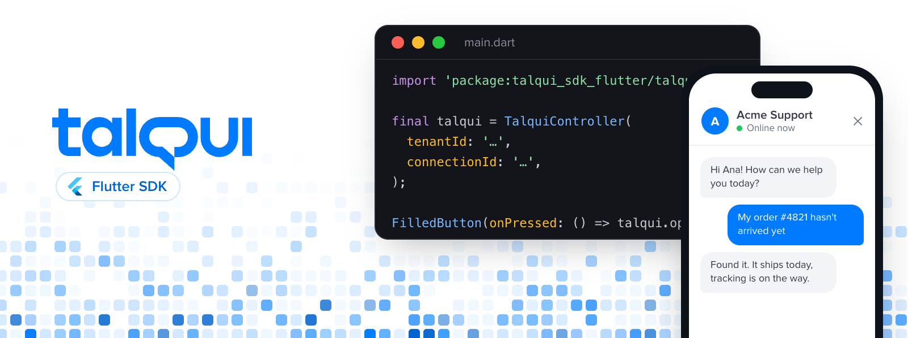
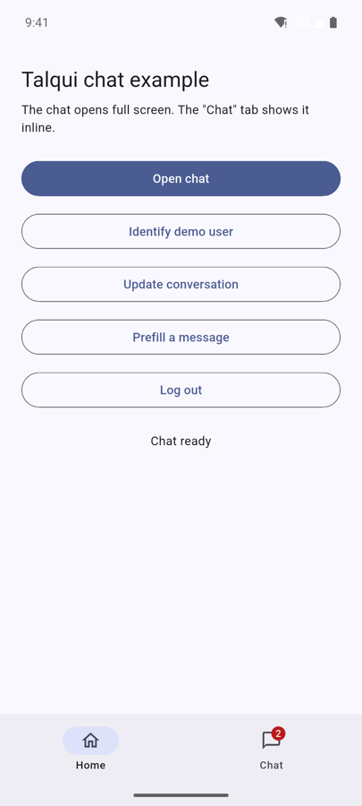
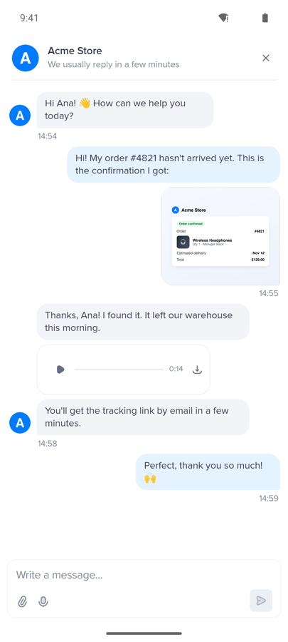
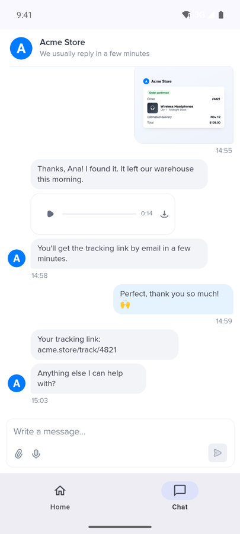

<div align="center"><strong>Talqui for Flutter</strong></div>
<div align="center">Live chat for your Flutter apps on iOS and Android.<br />Your users talk to your team, bots and AI agents without leaving the app.</div>
<br />
<div align="center">

[](https://pub.dev/packages/talqui_flutter)
[](https://flutter.dev)
[](https://pub.dev/packages/talqui_flutter)
[](https://github.com/talqui-oss/talqui-sdk-flutter/blob/main/LICENSE)

</div>
<div align="center">
<a href="https://docs.talqui.chat/guides/chat-sdks/flutter">Documentation</a>
<span> · </span>
<a href="https://pub.dev/packages/talqui_flutter">pub.dev</a>
<span> · </span>
<a href="https://github.com/talqui-oss/talqui-sdk-flutter/tree/main/example">Example app</a>
<span> · </span>
<a href="https://talqui.chat">Talqui</a>
</div>

## Introduction

[Talqui](https://talqui.chat) brings WhatsApp, Instagram, Mercado Livre, your website and your app into one inbox. This package adds the Talqui chat to a Flutter app: create a controller, call `open(context)` from any button, and the conversation lands in the same inbox your team already uses, with history, attachments, voice messages, bots and AI agents.

## Features

- **Full screen or inline.** `open(context)` from any button, or `TalquiChat` inside a tab.
- **Knows who is talking.** Pass the logged-in user and data about the conversation (an order, a plan, the screen they are on), at any moment.
- **Events and unread badge.** A stream of chat events and a `ValueListenable` unread count.
- **Safe logout.** One call and the next person on the phone starts from nothing.
- **Attachments work on Android** out of the box: the file picker is wired for you.
- **Small surface.** One controller, one widget. No state management library required.

## Screenshots

What your users see, from the [example app](https://github.com/talqui-oss/talqui-sdk-flutter/tree/main/example) on Android.

<table align="center">
  <tr>
    <td width="33%">
      
      <p align="center"><strong>Unread count</strong><br />Replies that arrive while the chat is closed</p>
    </td>
    <td width="33%">
      
      <p align="center"><strong>Full screen chat</strong><br />Text, images and voice messages</p>
    </td>
    <td width="33%">
      
      <p align="center"><strong>Inline in a tab</strong><br /><code>TalquiChat(hideCloseButton: true)</code></p>
    </td>
  </tr>
</table>

## Requirements

| | Minimum |
| --- | --- |
| Flutter | 3.24 (Dart 3.5) |
| iOS | 13 |
| Android | 7.0 (API 24) |

## Install

```bash
flutter pub add talqui_flutter
```

## Get your IDs

You need two values from your Talqui workspace, both on **app.talqui.chat → Plugins → WebChat → Installation**:

- **Tenant ID**: your workspace.
- **Connection ID**: the WebChat connection the app's conversations arrive through.

[Step by step with screenshots →](https://docs.talqui.chat/guides/chat-sdks/get-your-ids)

## Quick start

```dart
import 'package:flutter/material.dart';
import 'package:talqui_flutter/talqui_flutter.dart';

final talqui = TalquiController(
  tenantId: 'YOUR_TENANT_ID',
  connectionId: 'YOUR_CONNECTION_ID',
);

class Home extends StatelessWidget {
  const Home({super.key});

  @override
  Widget build(BuildContext context) {
    return FilledButton(
      onPressed: () => talqui.open(context),
      child: const Text('Talk to us'),
    );
  }
}
```

That's it. The chat opens in a full-screen route and closes with the header button or the back gesture. Create the controller once (a top-level variable, a `State`, Provider, Riverpod, GetIt…) and reuse it everywhere.

### Inline, in a tab

```dart
TalquiChat(controller: talqui, hideCloseButton: true)
```

`hideCloseButton` removes the close button from the chat header, which has nothing to close in a tab. Full screen always keeps it.

## Identify users

Once your user logs in, tell the chat who they are. The pre-chat form is skipped and your team sees the name, email and phone:

```dart
await talqui.identify(const TalquiUser(
  name: 'Ana Souza',
  email: 'ana@example.com',
  phone: '+5511999990000',
));
```

To keep a user's history across devices and reinstalls, also pass a `userHash`. Compute it **on your backend**, never in the app:

```
userHash = HMAC_SHA256(secret, "<tenantId>:<userId>")   // lowercase hex
```

Anyone holding a `userHash` can read that user's conversation, so treat it like a session token. [Read more →](https://docs.talqui.chat/guides/chat-sdks/identify-users)

## Metadata

Send context your team will see next to the conversation:

```dart
talqui.setContactMeta({'plan': 'pro', 'seats': 12});            // about the person, kept on their contact
talqui.setSessionMeta({'order_id': '4821', 'step': 'checkout'}); // about this conversation, change it any time
talqui.setSessionMeta({'step': null});                          // null removes a key
```

Keys use lowercase letters, digits, `_` and `-` (up to 60 chars). Values are strings, numbers or booleans, stored as text up to 255 chars. Calls made before the chat loads are queued and sent once it is ready. [Read more →](https://docs.talqui.chat/guides/chat-sdks/metadata)

## Events

```dart
talqui.events
    .where((event) => event.name == 'messageReceived')
    .listen((event) => print(event.payload['preview']));

ValueListenableBuilder<int>(
  valueListenable: talqui.unreadCount,
  builder: (context, unread, _) => Badge(
    isLabelVisible: unread > 0,
    label: Text('$unread'),
    child: const Icon(Icons.chat_bubble_outline),
  ),
);
```

| Event | When | Payload |
| --- | --- | --- |
| `ready` | The chat finished loading | `{protocol, webchatVersion, identity}` |
| `sessionStarted` | The user started a conversation | `{sessionId}` |
| `messageSent` | The user sent a message | `{messageId, type}` |
| `messageReceived` | Your team, a bot or an agent replied | `{messageId, type, preview, operatorName}` |
| `unreadChanged` | The unread count changed | `{count}` |
| `closeRequested` | The user tapped close in the header | `{}` |
| `openUrl` | The user tapped a link | `{url}` |
| `error` | A command was rejected | `{code, message}` |

[All events →](https://docs.talqui.chat/guides/chat-sdks/events)

## Logout

Call it when your user logs out. It forgets the user on this device, clears everything you set and starts a fresh anonymous visitor:

```dart
await talqui.logout();
```

## API

### `TalquiController`

| Member | |
| --- | --- |
| `TalquiController({tenantId, connectionId, onOpenUrl, debug})` | `tenantId` and `connectionId` are required. `onOpenUrl` handles links tapped in the chat (default: external browser). `debug` logs every message exchanged with the chat. |
| `open(context)` / `close()` | Show or hide the full-screen chat. The conversation keeps running while hidden. |
| `preload()` | Loads the chat ahead of time so `open` is instant and unread messages are counted. |
| `identify(user)` | Sets who the user is (`TalquiUser`: `name`, `email`, `phone`, `userHash`). |
| `setContact({name, email, phone})` | Updates the contact details. |
| `setContactMeta(meta)` / `setSessionMeta(meta)` | Custom data, see [Metadata](#metadata). |
| `prefill(text)` | Puts text in the message box. The user still decides to send it. |
| `logout()` | Forgets the user and starts a fresh visitor. |
| `events` | `Stream<TalquiEvent>` with `name` and `payload`. |
| `unreadCount`, `isReady` | `ValueNotifier<int>`, `ValueNotifier<bool>`. |
| `isOpen` | Whether the full-screen chat is showing. |
| `dispose()` | Releases the chat. Call it if you create the controller inside a `State`. |

### `TalquiChat`

| Parameter | Type | |
| --- | --- | --- |
| `controller` | `TalquiController` | Required. |
| `loading` | `Widget?` | Replaces the loading indicator. |
| `error` | `Widget Function(VoidCallback retry)?` | Replaces the screen shown when the chat cannot load. |
| `hideCloseButton` | `bool` | Hides the header's close button here. Default `false`. |

## Permissions

Attachments, photos and voice messages need these entries.

`ios/Runner/Info.plist`:

```xml
<key>NSCameraUsageDescription</key>
<string>Take photos to send in the support chat.</string>
<key>NSMicrophoneUsageDescription</key>
<string>Record voice messages for the support chat.</string>
<key>NSPhotoLibraryUsageDescription</key>
<string>Choose photos to send in the support chat.</string>
```

`android/app/src/main/AndroidManifest.xml`:

```xml
<uses-permission android:name="android.permission.INTERNET" />
<uses-permission android:name="android.permission.CAMERA" />
<uses-permission android:name="android.permission.RECORD_AUDIO" />
<uses-permission android:name="android.permission.MODIFY_AUDIO_SETTINGS" />
```

Keep `android:windowSoftInputMode="adjustResize"` on your activity (the Flutter default) so the keyboard never covers the message box.

## Example app

```bash
cd example
flutter run
```

It has an "Open chat" button, a "Chat" tab with an unread badge, and buttons for identify, metadata, prefill and logout, connected to the Talqui demo workspace.

## Troubleshooting

- **The attach or camera button does nothing**: the permissions above are missing.
- **The keyboard covers the message box**: don't present the chat in a bottom sheet; `open(context)` already uses a full-screen route.
- **"Invalid link" screen**: `tenantId` or `connectionId` is wrong.

[More →](https://docs.talqui.chat/guides/chat-sdks/troubleshooting)

## How it works

The SDK hosts the Talqui WebChat in a `webview_flutter` view and talks to it through a small, versioned message protocol ([`doc/BRIDGE_PROTOCOL.md`](https://github.com/talqui-oss/talqui-sdk-flutter/blob/main/doc/BRIDGE_PROTOCOL.md)). The visitor's identity lives in SharedPreferences, owned by the SDK, so logout is complete and the chat page itself keeps nothing between users. Chat features ship from Talqui's side without an app update.

## Contributing

Issues and pull requests are welcome. Run `flutter analyze` and `flutter test` before opening a PR.

## License

[MIT](https://github.com/talqui-oss/talqui-sdk-flutter/blob/main/LICENSE) © [Talqui](https://talqui.chat)
